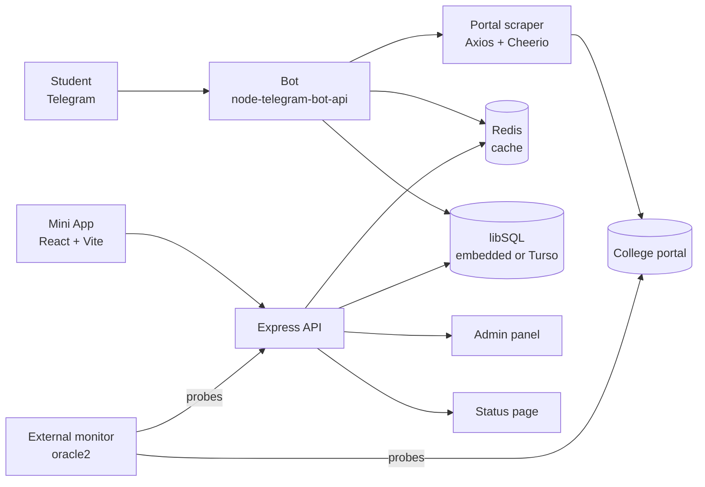

<div align="center">


# NbkristQik

**Attendance, mid-term marks and your syllabus — inside Telegram.**

A Telegram bot and companion web app for students of NBKRIST. Send a roll
number, get an answer in seconds. No install, no separate account.

[Bot](https://t.me/NbkristQik_bot) · [App](https://checker.tobioffice.dev/library/) · [Status](https://checker.tobioffice.dev/status) · [Website](https://tobioffice.github.io/NbkristQik/site/)

[](https://github.com/tobioffice/NbkristQik/actions/workflows/test.yml)
[](https://nodejs.org)
[](https://www.typescriptlang.org)
[](LICENSE.md)

</div>

---

## Overview

NbkristQik reads the college portal so students do not have to. Attendance
percentages, mid-term marks and a "how much can I bunk?" plan arrive as a
Telegram reply, formatted for a phone held in a corridor between classes.

The same service also runs a Telegram Mini App with the live leaderboard, an
optional roll-number profile, a watermarked library of semester material and a
threaded issue desk. Attendance itself is answered only in the chat. The
maintainer gets a private admin panel for activity, reports and uptime, and a
public status page for service health.

## Features

**For students**

- **Instant lookups** — send a roll number and get attendance, mid-term marks
  and a bunk plan without leaving the chat.
- **Optional registration** — save your roll once, then use `/attendance`,
  `/midmarks` and `/bunk` as one-tap commands. Edit it at any time.
- **Live leaderboard** — the attendance register ranks students by attendance
  or mid-term marks, filtered by year, branch and section. `/leaderboard`
  prints it in the chat; the button on any card opens it as a page.
- **Library** — read your semester's syllabus units as paged documents,
  watermarked for the signed-in reader. Download a watermarked PDF, or open
  the shelf on a computer with a one-time link from the bot. The shelf is
  admin-first until `LIBRARY_ACCESS=all`.
- **Issue reports** — file a report with a trackable id (for example
  `QIK-0007`) and keep the whole conversation with the admin in one thread.

**For the maintainer**

- **Admin panel** — overview, student search, live activity feed, report
  threads and 90-day health, behind a secret path and a password.
- **Uptime monitoring** — five-minute probes from a second host (oracle2) for
  the API, database, Redis and college portal, with Telegram alerts on state
  changes and a replay spool for outages.
- **Semester sync** — `/setsem` and `/syncdb` refresh sections from the portal
  without a redeploy.

## Architecture



A single Node process serves the bot (long polling), the REST API, the admin
panel and the status data. The Mini App is a static React build served
alongside it at `/library/`; the status page is a single static file that
Express serves at `/status`. Uptime probes are moving to a second host, so a
dead or overloaded production VM still produces an alert; the in-process probe
still runs alongside the external monitor until the external one is verified
in production. The schema is created idempotently on boot, so a fresh database
needs no migration step.

## Technology stack

| Layer      | Choice                                                            |
| ---------- | ----------------------------------------------------------------- |
| Runtime    | Node.js 22 or 24 (Node 20 is EOL), ESM, TypeScript 5             |
| Bot        | `node-telegram-bot-api`, long polling                             |
| API        | Express 5 with CORS, rate limiting and input validation           |
| Database   | libSQL/SQLite via `@libsql/client` — embedded file or Turso Cloud |
| Cache      | Redis 5                                                           |
| Scraping   | Axios and Cheerio                                                 |
| Frontend   | React 19, Vite 7 and Tailwind CSS                                 |
| Testing    | Vitest, v8 coverage, ESLint and Prettier                          |
| Deployment | systemd behind nginx; app and status page served same-origin  |

## Repository layout

```
.
├── src/
│   ├── api/          Express app, admin panel, API routes
│   ├── bot/          Entry point, commands and academic flows
│   ├── config/       Environment and logger
│   ├── constants/    Bot, web app and channel constants
│   ├── db/           libSQL client, schema and models
│   ├── middleware/   Request sanitisation and security
│   ├── services/     Portal scraping, caches, library, uptime, tracking
│   ├── status/       Static 90-day status page
│   ├── tools/        Library ingest and catalogue utilities
│   └── web/          React Mini App and marketing site (own package)
├── tests/            Unit and integration tests
├── docs/             Hand-written guides
├── scripts/          Deploy, backup and import helpers
└── assets/           Brand assets
```

## Getting started

### Prerequisites

- Node.js 22 or 24 (Node 20 is EOL; `.nvmrc` pins 24)
- pnpm 10
- A Redis instance
- A Telegram bot token from [@BotFather](https://t.me/BotFather)
- NBKRIST portal credentials with access to attendance and marks

Turso is optional. Without it, set `LOCAL_DB_URL` and the bot uses an embedded
SQLite file.

### Installation

```bash
git clone https://github.com/tobioffice/NbkristQik.git
cd NbkristQik
pnpm install
cp .env.example .env
```

Fill in the values in `.env` (see [Configuration](#configuration)), then start
the bot and API together:

```bash
pnpm dev
```

For the Mini App, run its package separately:

```bash
cd src/web
pnpm install
pnpm dev
```

### Configuration

The full list, with defaults, lives in [`.env.example`](.env.example) and
[`docs/DEPLOYMENT.md`](docs/DEPLOYMENT.md). The variables you will need first:

| Variable                                        | Purpose                                                                      |
| ----------------------------------------------- | ---------------------------------------------------------------------------- |
| `ENV`                                           | `production` by default; `development` must be explicit and also needs `ALLOW_DEV_IDENTITY=1` for the unsigned `userId` shortcut |
| `TELEGRAM_BOT_TOKEN` / `TELEGRAM_BOT_TOKEN_DEV` | Bot credentials                                                              |
| `N_USERNAME` / `N_PASSWORD`                     | College portal login                                                         |
| `ADMIN_ID`                                      | Telegram id allowed to run admin commands                                    |
| `REDIS_URL`                                     | Cache connection                                                             |
| `LOCAL_DB_URL`                                  | Embedded SQLite file; takes precedence over Turso                            |
| `TURSO_DATABASE_URL` / `TURSO_AUTH_TOKEN`       | Turso connection when `LOCAL_DB_URL` is unset                                |
| `ADMIN_PANEL_PATH` / `ADMIN_PANEL_PASSWORD`     | Admin panel location and password; the panel is disabled unless both are set |
| `UPTIME_INGEST_SECRET`                          | Shared secret for the external monitor's private `/internal/*` routes        |
| `CORS_ORIGINS`                                  | Comma-separated allowlist for the API                                        |
| `PORTAL_BASE_URL`                               | Optional portal override; plain HTTP by default                              |
| `HOST` / `PORT`                                 | API bind address and port; keep `HOST=127.0.0.1` behind nginx                 |
| `LIBRARY_ACCESS`                                | `admin` (default) or `all`                                                   |

## Commands

### Student

| Command        | What it does                                         |
| -------------- | ---------------------------------------------------- |
| `/start`       | Open the bot and its menu button                     |
| `/attendance`  | Attendance for your saved roll number                |
| `/midmarks`    | Mid-term marks for your saved roll number            |
| `/bunk`        | How many classes you can skip and stay above 75%     |
| `/register`    | Save your roll number once, edit it any time         |
| `/leaderboard` | Print the attendance register in the chat            |
| `/library`     | Open your semester's library, when the shelf is open |
| `/report`      | File an issue, or `/report <message>` directly       |
| `/help`        | How the bot works                                    |

Sending a roll number such as `23KB1A0599` works for everyone, registered or
not.

### Admin

| Command                    | What it does                                        |
| -------------------------- | --------------------------------------------------- |
| `/reply QIK-0007 <answer>` | Append to a report thread and notify the reporter   |
| `/close QIK-0007`          | Resolve a report and close its thread               |
| `/setsem 1\|2`             | Set the semester used by the next sync              |
| `/syncdb`                  | Refresh student sections from the portal            |
| `/postopen`                | Repost the "open me in private" card to the channel |

Admin commands are accepted only from `ADMIN_ID` and are not listed in the
public command menu.

## Web surfaces

| Surface        | Location                                                                                                            |
| -------------- | ------------------------------------------------------------------------------------------------------------------- |
| Mini App       | [`/library/`](https://checker.tobioffice.dev/library/) — hash routes `#/` (my attendance), `#/rank`, `#/profile`, `#/library`, `#/issues` |
| Status page    | [`/status`](https://checker.tobioffice.dev/status) — Express-served, live health and 90-day bars per component     |
| Admin panel    | `/<ADMIN_PANEL_PATH>` — Overview, Students, Live, Health, Reports                                                   |
| Marketing site | [NbkristQik site](https://tobioffice.github.io/NbkristQik/site/)                                                    |

API routes and their validation rules are documented in
[`docs/API.md`](docs/API.md). The Mini App authenticates with signed Telegram
`initData`; the admin panel uses a 24-hour HttpOnly session cookie and a
rate-limited login.

The status page is served by Express at `/status`. It is a single static file
with no external font or script request, and each 90-day bar exposes the day's
status as text with a keyboard and tap detail line.

## Development

| Script                 | What it does                        |
| ---------------------- | ----------------------------------- |
| `pnpm dev`             | Run the bot and API from TypeScript |
| `pnpm build`           | Compile to `dist/`                  |
| `pnpm start`           | Run the compiled build              |
| `pnpm lint`            | ESLint over `src/` and `tests/`     |
| `pnpm typecheck`       | Type-check without emitting         |
| `pnpm format`          | Format with Prettier                |
| `pnpm exec vitest run` | Run the test suite once             |
| `pnpm test:coverage`   | Run tests with a coverage report    |

`pnpm test` starts Vitest in watch mode; use `pnpm exec vitest run` in scripts
and CI.

Continuous integration runs lint, type-check, a production dependency audit and
coverage on Node 22 and 24, and a separate job for the web package's lint,
unit tests and the same-origin `/library/` build. Every pull request to `main`
or `develop` runs the same checks.

## Deployment

The bot runs as the `nbkristqik` systemd service. Builds happen locally because
the production host has little memory, and only `dist/` and the static
surfaces are shipped:

```bash
scripts/deploy.sh
```

The deploy refuses a dirty working tree (staged, unstaged or untracked files;
`ALLOW_DIRTY_DEPLOY=1` is the documented hotfix escape), then runs typecheck,
lint and the tests before building. On the server it stages the new build as
`dist.new`, keeps the replaced build as `dist.old` until the smoke checks pass,
then promotes it to `dist.prev`; takes a `VACUUM INTO` backup when
`DEPLOY_DB_URL` is set; ships `dist/`, the manifests, ops scripts,
`src/status` → `public/status`, the library bundle and the syllabus catalogue;
installs production dependencies with a frozen lockfile; restarts the service;
and smoke-checks `/health`, `/status`, `/library/` and a hashed asset. A failed
check restores `dist.old`, restarts the old build and exits non-zero. Defaults: host `oracle3`, directory `/home/ubuntu/nbkristqik`,
service `nbkristqik`, loopback `http://127.0.0.1:3000`; override with
`DEPLOY_HOST`, `DEPLOY_DIR`, `DEPLOY_SERVICE` and `DEPLOY_BASE_URL`. See
[`docs/DEPLOYMENT.md`](docs/DEPLOYMENT.md) for the backup and internal-check
variables. The host must run Node 22 or 24; Node 20 is EOL.

The web app is one Vite build, served at `/library/` and shipped by the deploy
script:

```bash
cd src/web
pnpm build        # same build as build:library
```

The marketing site has its own Pages-only deploy:

```bash
cd src/web
pnpm deploy:site  # stages public/site/ and publishes it with gh-pages
```

`build`/`build:library` build only the `/library/` app. The old standalone app
entry points and the old `pnpm deploy` command are gone; `deploy:site` is now
the only gh-pages deploy.

The uptime monitor deploys separately to oracle2 as the
`nbkristqik-uptime` systemd service; it needs only
`dist/monitor/index.js`, a root-owned environment file and a writable state
directory. See [`docs/DEPLOYMENT.md`](docs/DEPLOYMENT.md) for the hardened
unit and the one-time setup. The in-process probe stays enabled alongside the
external monitor until fresh external heartbeats have been verified in the
90-day history.

## Documentation

| Document                                           | Contents                                    |
| -------------------------------------------------- | ------------------------------------------- |
| [`docs/ARCHITECTURE.md`](docs/ARCHITECTURE.md)     | Runtime, data flow and module map           |
| [`docs/API.md`](docs/API.md)                       | REST endpoints, parameters and responses    |
| [`docs/DATABASE.md`](docs/DATABASE.md)             | Schema, models and caching                  |
| [`docs/DEPLOYMENT.md`](docs/DEPLOYMENT.md)         | Environment, build and production           |
| [`docs/LIBRARY.md`](docs/LIBRARY.md)               | Library, reader and watermarking            |
| [`docs/DOCUMENTS.md`](docs/DOCUMENTS.md)           | Document ingest and catalogue               |
| [`docs/SITE.md`](docs/SITE.md)                     | Marketing site                              |
| [`docs/ROADMAP.md`](docs/ROADMAP.md)               | Decided but unbuilt work                    |
| [`DESIGN.md`](DESIGN.md)                           | Design system, binding before any UI change |
| [`PRODUCT.md`](PRODUCT.md)                         | Product brief, users and principles         |

If a hand-written guide and the code disagree, the code wins.

## Contributing

Contributions are welcome. Read
[`docs/CONTRIBUTING.md`](docs/CONTRIBUTING.md) for the workflow, coding
standards and commit conventions. Before opening a pull request, run:

```bash
pnpm lint
pnpm typecheck
pnpm exec vitest run
```

## License

Released under the [MIT License](LICENSE.md).
