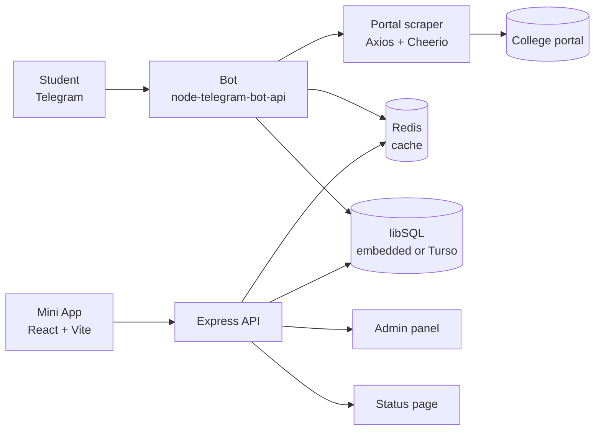

<div align="center">


# NbkristQik

**Attendance, mid-term marks and your syllabus — inside Telegram.**

A Telegram bot and companion web app for students of NBKRIST. Send a roll
number, get an answer in seconds. No install, no separate account.

[Bot](https://t.me/NbkristQik_bot) · [App](https://checker.tobioffice.dev/library/) · [Status](https://checker.tobioffice.dev/status) · [Website](https://tobioffice.github.io/NbkristQik/site/)

[](https://github.com/tobioffice/NbkristQik/actions/workflows/test.yml)
[](https://nodejs.org)
[](https://www.typescriptlang.org)
[](LICENSE.md)

</div>

---

## Overview

NbkristQik reads the college portal so students do not have to. Attendance
percentages, mid-term marks and a "how much can I bunk?" plan arrive as a
Telegram reply, formatted for a phone held in a corridor between classes.

The same service also runs a Telegram Mini App with the live leaderboard, an
optional roll-number profile, a watermarked library of semester material and a
threaded issue desk. The maintainer gets a private admin panel for activity,
reports and uptime, and a public status page for service health.

## Features

**For students**

- **Instant lookups** — send a roll number and get attendance, mid-term marks
  and a bunk plan without leaving the chat.
- **Optional registration** — save your roll once, then use `/attendance`,
  `/midmarks` and `/bunk` as one-tap commands. Edit it at any time.
- **Live leaderboard** — the attendance register ranks students by attendance
  or mid-term marks, filtered by year, branch and section.
- **Library** — read your semester's syllabus units as paged documents,
  watermarked for the signed-in reader.
- **Issue reports** — file a report with a trackable id (for example
  `QIK-0007`) and keep the whole conversation with the admin in one thread.

**For the maintainer**

- **Admin panel** — overview, student search, live activity feed, report
  threads and 90-day health, behind a secret path and a password.
- **Uptime monitoring** — five-minute probes for the API, database, Redis and
  college portal, with Telegram alerts on state changes.
- **Semester sync** — `/setsem` and `/syncdb` refresh sections from the portal
  without a redeploy.
- **Daily check-in** — an optional pinned channel post that unlocks the bot for
  the day.

## Architecture



A single Node process serves the bot (long polling), the REST API, the admin
panel and the health probes. The Mini App is a static React build served
alongside it; the status page is a single static file. The schema is created
idempotently on boot, so a fresh database needs no migration step.

## Technology stack

| Layer      | Choice                                                            |
| ---------- | ----------------------------------------------------------------- |
| Runtime    | Node.js 20 or newer, ESM, TypeScript 5                            |
| Bot        | `node-telegram-bot-api`, long polling                             |
| API        | Express 5 with CORS, rate limiting and input validation           |
| Database   | libSQL/SQLite via `@libsql/client` — embedded file or Turso Cloud |
| Cache      | Redis 5                                                           |
| Scraping   | Axios and Cheerio                                                 |
| Frontend   | React 19, Vite 7 and Tailwind CSS                                 |
| Testing    | Vitest, v8 coverage, ESLint and Prettier                          |
| Deployment | systemd on a Linux host; static assets on GitHub Pages            |

## Repository layout

```
.
├── src/
│   ├── api/          Express app, admin panel, API routes
│   ├── bot/          Entry point, commands, academic and check-in flows
│   ├── config/       Environment and logger
│   ├── constants/    Bot, web app and channel constants
│   ├── db/           libSQL client, schema and models
│   ├── middleware/   Request sanitisation and security
│   ├── services/     Portal scraping, caches, library, uptime, tracking
│   ├── status/       Static 90-day status page
│   ├── tools/        Library ingest and catalogue utilities
│   └── web/          React Mini App and marketing site (own package)
├── tests/            Unit and integration tests
├── docs/             Hand-written guides
├── openwiki/         Generated, source-grounded wiki
├── scripts/          Deploy, backup and import helpers
└── assets/           Brand assets
```

## Getting started

### Prerequisites

- Node.js 20 or newer
- pnpm 10
- A Redis instance
- A Telegram bot token from [@BotFather](https://t.me/BotFather)
- NBKRIST portal credentials with access to attendance and marks

Turso is optional. Without it, set `LOCAL_DB_URL` and the bot uses an embedded
SQLite file.

### Installation

```bash
git clone https://github.com/tobioffice/NbkristQik.git
cd NbkristQik
pnpm install
cp .env.example .env
```

Fill in the values in `.env` (see [Configuration](#configuration)), then start
the bot and API together:

```bash
pnpm dev
```

For the Mini App, run its package separately:

```bash
cd src/web
pnpm install
pnpm dev
```

### Configuration

The full list, with defaults, lives in [`.env.example`](.env.example) and
[`docs/DEPLOYMENT.md`](docs/DEPLOYMENT.md). The variables you will need first:

| Variable                                        | Purpose                                                                      |
| ----------------------------------------------- | ---------------------------------------------------------------------------- |
| `ENV`                                           | `development` or `production`; selects the token and channel                 |
| `TELEGRAM_BOT_TOKEN` / `TELEGRAM_BOT_TOKEN_DEV` | Bot credentials                                                              |
| `N_USERNAME` / `N_PASSWORD`                     | College portal login                                                         |
| `ADMIN_ID`                                      | Telegram id allowed to run admin commands                                    |
| `REDIS_URL`                                     | Cache connection                                                             |
| `LOCAL_DB_URL`                                  | Embedded SQLite file; takes precedence over Turso                            |
| `TURSO_DATABASE_URL` / `TURSO_AUTH_TOKEN`       | Turso connection when `LOCAL_DB_URL` is unset                                |
| `ADMIN_PANEL_PATH` / `ADMIN_PANEL_PASSWORD`     | Admin panel location and password; the panel is disabled unless both are set |
| `CORS_ORIGINS`                                  | Comma-separated allowlist for the API                                        |
| `PORTAL_BASE_URL`                               | Optional portal override; plain HTTP by default                              |
| `LIBRARY_ACCESS`                                | `admin` (default) or `all`                                                   |

## Commands

### Student

| Command        | What it does                                         |
| -------------- | ---------------------------------------------------- |
| `/start`       | Open the bot and its menu button                     |
| `/attendance`  | Attendance for your saved roll number                |
| `/midmarks`    | Mid-term marks for your saved roll number            |
| `/bunk`        | How many classes you can skip and stay above 75%     |
| `/register`    | Save your roll number once, edit it any time         |
| `/leaderboard` | Open the attendance register                         |
| `/library`     | Open your semester's library, when the shelf is open |
| `/report`      | File an issue, or `/report <message>` directly       |
| `/help`        | How the bot works                                    |

Sending a roll number such as `23KB1A0599` works for everyone, registered or
not.

### Admin

| Command                    | What it does                                        |
| -------------------------- | --------------------------------------------------- |
| `/reply QIK-0007 <answer>` | Append to a report thread and notify the reporter   |
| `/close QIK-0007`          | Resolve a report and close its thread               |
| `/setsem 1\|2`             | Set the semester used by the next sync              |
| `/syncdb`                  | Refresh student sections from the portal            |
| `/postcheckin`             | Post and pin today's channel check-in               |
| `/postopen`                | Repost the "open me in private" card to the channel |

Admin commands are accepted only from `ADMIN_ID` and are not listed in the
public command menu.

## Web surfaces

| Surface        | Location                                                                                                            |
| -------------- | ------------------------------------------------------------------------------------------------------------------- |
| Mini App       | [`/library/`](https://checker.tobioffice.dev/library/) — hash routes `#/rank`, `#/profile`, `#/library`, `#/issues` |
| Status page    | [`/status`](https://checker.tobioffice.dev/status) — live health and 90-day bars per component                      |
| Admin panel    | `/<ADMIN_PANEL_PATH>` — Overview, Students, Live, Health, Reports                                                   |
| Marketing site | [NbkristQik site](https://tobioffice.github.io/NbkristQik/site/)                                                    |

API routes and their validation rules are documented in
[`docs/API.md`](docs/API.md). The Mini App authenticates with signed Telegram
`initData`; the admin panel uses a 24-hour HttpOnly session cookie and a
rate-limited login.

## Development

| Script                 | What it does                        |
| ---------------------- | ----------------------------------- |
| `pnpm dev`             | Run the bot and API from TypeScript |
| `pnpm build`           | Compile to `dist/`                  |
| `pnpm start`           | Run the compiled build              |
| `pnpm lint`            | ESLint over `src/` and `tests/`     |
| `pnpm typecheck`       | Type-check without emitting         |
| `pnpm format`          | Format with Prettier                |
| `pnpm exec vitest run` | Run the test suite once             |
| `pnpm test:coverage`   | Run tests with a coverage report    |

`pnpm test` starts Vitest in watch mode; use `pnpm exec vitest run` in scripts
and CI.

Continuous integration runs lint, type-check, a production dependency audit and
coverage on Node 20, and a separate job for the web package's lint, tests and
production build. Every pull request to `main` or `develop` runs the same
checks.

## Deployment

The bot runs as the `nbkristqik` systemd service. Builds happen locally because
the production host has little memory, and only `dist/` is shipped:

```bash
scripts/deploy.sh
```

The script builds, rsyncs `dist/` and the manifests, installs production
dependencies with a frozen lockfile, restarts the service and verifies it is
active. It expects the `oracle3` SSH alias by default; see
[`docs/DEPLOYMENT.md`](docs/DEPLOYMENT.md) for host, directory and service
overrides. The web package deploys to GitHub Pages with
`cd src/web && pnpm deploy`.

## Documentation

| Document                                           | Contents                                    |
| -------------------------------------------------- | ------------------------------------------- |
| [`docs/ARCHITECTURE.md`](docs/ARCHITECTURE.md)     | Runtime, data flow and module map           |
| [`docs/API.md`](docs/API.md)                       | REST endpoints, parameters and responses    |
| [`docs/DATABASE.md`](docs/DATABASE.md)             | Schema, models and caching                  |
| [`docs/DEPLOYMENT.md`](docs/DEPLOYMENT.md)         | Environment, build and production           |
| [`docs/LIBRARY.md`](docs/LIBRARY.md)               | Library, reader and watermarking            |
| [`docs/DOCUMENTS.md`](docs/DOCUMENTS.md)           | Document ingest and catalogue               |
| [`docs/SITE.md`](docs/SITE.md)                     | Marketing site                              |
| [`DESIGN.md`](DESIGN.md)                           | Design system, binding before any UI change |
| [`PRODUCT.md`](PRODUCT.md)                         | Product brief, users and principles         |
| [`openwiki/quickstart.md`](openwiki/quickstart.md) | Generated, source-grounded wiki             |

If a hand-written guide and the generated wiki disagree, the code and
`openwiki/` are authoritative.

## Contributing

Contributions are welcome. Read
[`docs/CONTRIBUTING.md`](docs/CONTRIBUTING.md) for the workflow, coding
standards and commit conventions. Before opening a pull request, run:

```bash
pnpm lint
pnpm typecheck
pnpm exec vitest run
```

## License

Released under the [MIT License](LICENSE.md).
